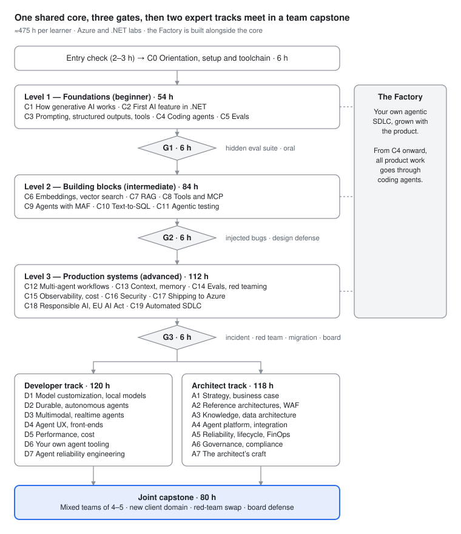

# Преглед на курса

*AI Solution Developer & AI Solution Architect — от разработчик до експерт*

> **Версия на курса:** 2026.11 (съдържание към октомври 2026 г.) · **Общо натоварване:** ≈ 475 ч на курсист (ядро 274 ч + една експертна специализация ≈ 120 ч + съвместен финален проект 80 ч) · **Стек:** Azure + .NET 10 на първо място, с ограничено използване на Python и Node.js · **Формат:** учене чрез правене върху един развиващ се продукт, с гейтове (gate, практически изпит), базирани на скрити набори от evals (автоматизирани оценки на качеството), преглед на кода (code review) и защита на дизайна

## Обещанието, казано направо

Работите като софтуерен разработчик, но AI е нов за вас. За около 475 часа целенасочена практика ще изградите, тествате, защитите, пуснете, експлоатирате и управлявате един реалистичен продукт с LLM и агенти: Fleet Ops Copilot за измислената логистична компания Trakia Freight. Ще го изграждате чрез собствен агентен pipeline за доставка на софтуер, **Фабриката** (Factory, вашият агентен SDLC), в който кодиращите агенти (coding agents) пишат по-голямата част от кода, а вие задавате спецификациите и ограниченията и проверявате работата им. След това навлизате в дълбочина в една от двете експертни специализации, Developer или Architect, и защитавате екипен финален проект (capstone) за нов клиент от друга област пред комисия за преглед. „Експерт“ тук означава **доказана и оценена компетентност при задачи на експертно ниво**. Ще диагностицирате грешки по traces, ще проектирате проверката преди имплементацията, ще избирате архитектурата с най-ниска сложност, която минава evals, и ще защитавате всяко решение с доказателства за разходите, риска и качеството. Това не означава сениор ниво. То все още се придобива с години работа с продукционни системи. Курсът ви дава навиците, портфолиото и преценката, благодарение на които тези години ще имат стойност, плюс честна картина на това какво можете и какво все още не можете.

**Какво не е курсът:** обиколка на продуктите на Azure (те пак ще бъдат преименувани), курс за трикове с промптове, курс по ML изследвания (няма да обучавате базови модели) или зубрене за сертификат. Съответствието със сертификациите е описано по-долу, но взетият изпит при доставчик е страничен ефект, а не цел.

---

## 1. За кого е курсът

**Входен профил:** практикуващ разработчик на произволен език, който работи уверено с Git (клонове (branches), PR-и, rebase), HTTP/REST и JSON, SQL (joins, агрегиране, индекси), рамка за unit тестове и контейнери на ниво „стартирай compose файл“. Не се изискват предишни знания по AI или ML. Ако не знаете C#, C0 ви учи достатъчно, за да започнете, а владеенето на езика расте заедно с лабораторните упражнения.

**Не е подходящ (засега) за:** хора, които никога не са пускали код в споделено хранилище, хора, които търсят път без код (Copilot Studio се разглежда като архитектурен вариант, а не като среда за учене), и ML изследователи, които искат да обучават модели (вж. границата спрямо AWS AIP-C01 по-долу: това е курс по AI инженеринг, а не по ML инженеринг).

### Входна проверка (≈ 2–3 ч, самостоятелно, на доверие)

Изпълнете и четирите задачи без AI асистент. Целта е да калибрирате основните си умения, защото по-нататък курсът разчита на способността ви да преценявате код, който не сте писали сами.

1. **Изграждане:** на произволен език имплементирайте `GET /vehicles/{id}/trips?from=&to=` върху предоставения SQLite файл `entry/trakia-mini.db`. Връщайте 404 за непознати превозни средства и 400 за невалиден интервал от дати и добавете странициране. Напишете поне 5 unit или интеграционни теста. Отворете PR към собствения си fork.
2. **Заявка:** напишете една SQL заявка, която за всяко депо връща 3-те превозни средства с най-много събития на рязко спиране на 100 км през последните 30 дни, като при равенство подрежда по id на превозното средство.
3. **Четене:** по даден C# файл от 150 реда и Python файл от 100 реда (`entry/read/`) отговорете на 6 въпроса за поведението им. В един от тях е скрита грешка на единица (off-by-one), а в друг — грешка с async/await.
4. **Експлоатация:** стартирайте предоставения `docker compose up`, открийте защо контейнерът на API-то се рестартира (причината е в логовете) и я отстранете.

**Индикатор за успех:** и четирите задачи са готови за по-малко от 3 часа, тестовете минават. Ако ви трябват повече от около 5 часа, първо запълнете пропуските (основите на Git, SQL и тестването). Курсът няма да ги преподава, а гейтовете ги приемат за даденост.

**Хардуер и акаунти:** минимум 16 GB RAM, препоръчително 32 GB (модели на Foundry Local плюс Docker плюс SQL Server; точните изисквания за памет на моделите варират, затова проверете в актуалната документация (списъка с модели на Foundry Local)). Docker или Codespaces, GitHub акаунт, абонамент за Azure, в който можете да създавате групи ресурси (раздел 8), и достъп до поне един кодиращ агент (GitHub Copilot с agent mode и/или Claude Code).

---

## 2. Компетентности при завършване

Завършилият курса може да прави следното, като всяка точка се оценява чрез гейт, проверка за приемане в лабораторно упражнение или финалния проект (вж. [Матрица на компетентностите](competency-matrix.md) за пълната рамка):

1. **Обяснява и предвижда поведението на моделите в инженерни термини.** Това включва токените и цената им (включително българския текст, който изисква повече токени), недетерминизма при семплирането (температура 0 не е детерминистична при продукционно обслужване), усилието за разсъждение (reasoning effort), бюджетите на контекста и кога *да не* се използва LLM.
2. **Изгражда AI функционалности в .NET, независими от доставчика,** върху `Microsoft.Extensions.AI`, при които смяната на модела (облак ↔ Foundry Local ↔ всеки OpenAI-съвместим endpoint) е промяна в конфигурацията, последвана от успешно изпълнение на evals.
3. **Проектира извличане (retrieval),** което е хибридно, с повторно класиране, филтрирано по права на достъп (security trimming) и многоезично, и **измерва поотделно извличането и генерирането**.
4. **Проектира инструменти и MCP сървъри** за агенти: обединени, със странициране и с грешки с указания за поправка (actionable errors). Пуска MCP сървър без състояние по спецификацията 2026-07-28.
5. **Избира архитектурата с най-ниска сложност, която минава evals:** промпт → workflow (работен поток с предварително зададени стъпки) → един агент → много агенти. Имплементира я с Microsoft Agent Framework с бюджети, контролни точки и одобрение от човек.
6. **Прилага оценяване, водено от грешките:** анализ на грешките върху реални traces, таксономия на грешките, бинарни оценители (evaluators) за всеки вид грешка (failure mode), LLM съдии, калибрирани спрямо етикети, поставени от човек (TPR/TNR — дял на верните положителни / верните отрицателни резултати), оценки на траекторията (trajectory evals) и гейтове в CI.
7. **Експлоатира AI системи:** traces от край до край с OpenTelemetry, цена на задача, миграция на модел с решение „да/не“ (go/no-go) въз основа на evals за всеки вид грешка и диагностика на инциденти по traces.
8. **Осигурява сигурността на агентни системи на ниво архитектура:** анализ на смъртоносната тройка (lethal trifecta), минимална агентност (least agency), идентичност на агентите, guardrails (защитни механизми) като втори слой, контроли на веригата на доставки за MCP и red teaming (атакуващо тестване) с измерен процент успешни атаки.
9. **Управлява (governance):** класифицира система според Акта за изкуствения интелект (AI Act) на ЕС, изменен с Регламент (ЕС) 2026/1744, изготвя досието за риска (risk file), проектира човешкия надзор и съпоставя практиката с NIST AI RMF и ISO/IEC 42001.
10. **Доставя чрез агенти:** управлява контролиран агентен SDLC (памет на хранилището, skills (пакети с процедурни знания за агента), hooks (команди, изпълнявани при събития от жизнения цикъл на агента), спецификации с тестове на първо място, мутационни и eval гейтове, облачни агенти от issue до PR, преглед от AI, SRE агент) и може да **обясни и защити всеки слят ред**.
11. **Специализация AI Solution Developer:** проектира с оглед на производителността, разходите, устойчивостта и надеждността (pass^k, симулатори, внасяне на откази), адаптира модели, когато evals го оправдават, и изгражда собствени инструменти за агенти.
12. **Специализация AI Solution Architect:** преминава от бизнес проблем към портфолио, бизнес обосновка (business case) с ROI (възвръщаемост на инвестицията) и TCO (обща цена на притежание) и решение изграждане / покупка / разширяване (build / buy / extend), референтна архитектура и landing zone (базова среда в Azure с готово управление и мрежа), многотенантен gateway, план за жизнения цикъл на моделите и DR (възстановяване след бедствие), FinOps, система за управление и оперативен модел на програмата, и защитава всичко това пред комисия за преглед.

---

## 3. Две роли, едно техническо ядро

Пазарът на труда и обновените сертификации през 2026 г. описват две свързани роли. Анализите на обяви за работа в САЩ (от един източник за анализ на набирането на кадри, затова ги приемайте само като ориентир) представят **AI инженера** като практик, който изгражда: Python 62%, облак 55%, базови модели 51%, с RAG (генериране, допълнено с извличане) и наблюдаемост (observability) в основния стек. **AI архитектът** се явява като „дизайнерска роля с компонент на изграждане, а не обратното“: облачни платформи 60,9%, Python 43,9%, наблюдаемост 38,9%, базови модели 37,8%, RAG 28,1%, CI/CD 26,2%, Azure се споменава в 42,5% от обявите, а изискваният опит обикновено е около 7 години. Сертификациите на Microsoft се разделят по същия начин: **AI-103** (AI Apps and Agents Developer) и **AB-100** (Agentic AI Business Solutions Architect; наставката „Expert“ в заглавието: проверете в актуалната документация).

| | **AI Solution Developer** | **AI Solution Architect** |
|---|---|---|
| Основен резултат | Работещи, оценени, наблюдаеми и сигурни AI функционалности и агенти в продукция | Решения и структури, благодарение на които AI функционалностите на много екипи са сигурни, достъпни като цена и устойчиви |
| Отговаря за | Имплементацията, наборите от evals и съдиите, дизайна на инструментите и MCP, производителността и цената на задача, инженеринга на надеждността, Фабриката на екипа | Портфолиото от сценарии на употреба (use cases) и бизнес обосновката, референтната архитектура и landing zone, gateway и модела на тенантност, стратегията за жизнения цикъл на моделите и DR, системата за управление, ADR-ите (записи на архитектурни решения), процеса на преглед |
| Типични артефакти | Код, evals, traces, поправки след red teaming, runbooks (оперативни инструкции), постмортеми | ADR-и, модели C4, модели на заплахите, модели на разходите, DR планове, досиета за риска по Акта за ИИ, WAF AI оценки (по Azure Well-Architected Framework), бележки за заинтересованите страни |
| Решава | *Как* (в рамките на ограниченията): стратегията за извличане, дизайна на цикъла на агента, разположението на промпта и контекста, кой вид грешка заслужава оценител | *Дали и какво* (задава ограниченията): изграждане/покупка/разширяване, кои модели и региони, апетит за риск, тенантност, SLO-та, бюджети, дизайн на надзора |
| Успехът се измерва с | Резултати от скритите evals, pass^k, мутационен резултат (mutation score), цена на задача, пропуснати дефекти | Решения на комисията за преглед, точност на модела на разходите спрямо реалните разходи, резултати от DR учения, готовност за одит, доказателства за възприемане и ROI |
| Целево ниво при завършване (в стил SFIA, извод на авторите на курса) | Ниво 4–5 („enable“, „ensure and advise“) | Ниво 5–6 („ensure and advise“, „initiate and influence“) |

**Припокриването е умишлено.** И двете роли минават едно и също 274-часово ядро, а архитектите изграждат в ядрото всичко, което изграждат и разработчиците. Архитект, който не може да прочете trace, да изпълни eval или да забележи смъртоносната тройка в дизайн, произвежда само слайдове. На разработчик, който не може да напише ADR, да оцени цената на задача или да обясни класификацията на дадена функционалност според Акта за ИИ, не може да се повери самостоятелност. Специализациите се различават по **дълбочината на инженерната работа** (D) срещу **широтата на преценката** (A) и се срещат отново във финалния проект, където смесени екипи трябва да накарат двете да работят заедно.

---

## 4. Структура на курса

Ядрото е последователно, защото всеки модул добавя продуктов инкремент, върху който надгражда следващият. В рамките на специализацията AI Solution Developer редът е препоръчителен, но не задължителен (за D5 се препоръчва D1; за D7 — D2 и D5). Специализацията AI Solution Architect на практика е последователна, защото предварителните изисквания на всеки модул посочват предходните (A3 изисква A2; A4 — A2–A3; A5 — A1, A2 и A4; A6 — A1–A5; A7 — A1–A6). Курсистите могат да минат и двете специализации (+≈ 120 ч). Финалният проект изисква G3 и поне 4 от 7-те модула на една специализация, като останалите модули от специализацията могат да вървят паралелно (вж. темпото).

---

## 5. Продуктът, който развивате, и Фабриката

### Trakia Freight и Fleet Ops Copilot

**Trakia Freight** е измислена логистична компания със среден размер и седалище в Пловдив, България. Тя има около 400 камиона, около 600 шофьори, три депа (Пловдив, София, Варна) и международни маршрути в ЕС. Всички данни са синтетични и безопасни от гледна точка на GDPR (Общ регламент относно защитата на данните). Генерират се с инструменти с фиксиран seed в хранилището за лабораторните упражнения (`trakia-fleetops`, `/data`):

- **База данни `TrakiaOps` в SQL Server 2025:** превозни средства, псевдонимизирани шофьори, курсове, около 5 млн. телематични събития (GPS, рязко спиране, гориво, кодове за неизправност на двигателя), работни поръчки за поддръжка, части, клиенти, пратки и инциденти.
- **Корпус от около 1500 документа на български и английски:** наръчник с правилата за автопарка, кодекс за поведение на шофьорите, HR политики, ръководства за поддръжка (PDF файлове с таблици), обобщения на правилата на ЕС за времето на управление и тахографите, SLA с клиенти, доклади за инциденти и сканирани товарителници.
- **Mock API-та** (OpenAPI): тикети, планиране, доставчик на части и известия (имейл/Teams).
- **Модел на ролите с ACL за документите:** диспечер, мениджър на автопарка, механик, шофьор, HR, обслужване на клиенти и одитор.

Защо точно тази област: в нея има структурирани и неструктурирани данни, реални права на достъп, действия, свързани с безопасността (заявяване на поддръжка, известяване на клиенти), потребители на български език и истински **капан на Акта за ИИ на ЕС**. Функционалностите за наблюдение на шофьорите засягат сценариите на употреба от областта на заетостта в приложение III, които курсистите трябва да разпознаят и да заобиколят с дизайна си в C18. Областта е достатъчно сложна, за да се провали видимо подходът „просто добавете агент“.

**Продуктови инкременти:** стрийминг чат „Ask Fleet Ops“ (C2) → типизирано извличане на инциденти и първи инструмент (C3) → хранилище, готово за агенти (C4) → еталонен набор (golden set) и evals в CI (C5) → семантично търсене (C6) → BG/EN RAG с цитати, съобразен с правата на достъп (C7) → MCP сървър на Trakia (C8) → агент Fleet Assistant с одобрение от човек (C9) → text-to-SQL агент Fleet Analyst (C10) → пълна тестова пирамида, поддържана от агенти (C11) → многоагентен workflow за инциденти (C12) → дългосрочна памет и GraphRAG (C13) → продукционен набор от evals и доклад от red teaming (C14) → пълно проследяване (tracing) и цена на задача (C15) → модел на заплахите и укрепване на защитата (C16) → разгръщане зад AI gateway (единна точка за политики върху трафика към моделите), с достъп през A2A и Teams (C17) → досие за риска по Акта за ИИ (C18) → напълно автоматизиран SDLC под наблюдението на SRE агент (C19). Разработческата специализация добавя гласов асистент в реално време за шофьорите, класификатор на кодове за неизправност, дообучен чрез fine-tuning (дообучаване), който работи на Foundry Local в депата, устойчив (durable) агент за планиране на автопарка и собствени инструменти за агенти. Архитектурната специализация превръща продукта в многотенантно решение, което Trakia продава на други автопаркове, с landing zone, платформа за знания, регистър на агентите, DR/FinOps и система за управление в стил ISO/IEC 42001.

### Фабриката

Успоредно с продукта всеки курсист изгражда **Фабриката**: собствената си агентна система за доставка на софтуер. Тя обхваща средата като код (C0); файловете с паметта на хранилището (AGENTS.md, CLAUDE.md, copilot-instructions), цикъла план → имплементация → проверка, skills и hooks с настройки на правата (C4); eval тестовете, които агентите трябва да изпълнят, преди да обявят задачата за завършена (C5); кодиращите агенти, които използват собствените MCP сървъри на проекта (C8); спецификациите с тестове на първо място, мутационните гейтове и тестовите агенти на Playwright (C11); eval гейтовете и агента за сортиране на регресии в CI (C14); версионирането на промптове и модели (C15); агентите за сигурност като агентния CodeQL autofix, сканирането за секрети и списъците с разрешени пакети (allow-lists) (C16); и пълния цикъл от issue през PR от облачен агент, преглед от AI, човешки гейт и разгръщане до SRE агент (C19). Тя се разширява със собствени инструменти за агенти върху Copilot SDK или Claude Agent SDK (D6) и с управление и метрики на Фабриката (A7).

**От C4 нататък цялата работа по продукта минава през Фабриката.** Оценява се как насочвате, ограничавате и проверявате агентите, а не колко клавиша натискате. Причината са данните за доставката на софтуер с помощта на AI. DORA 2025 установява, че AI действа като „огледало и множител“ на съществуващите практики. Рандомизираното изпитване на METR от началото на 2025 г. показва, че опитните разработчици са с около 19–20% по-бавни, докато вярват, че са с около 20% по-бързи; актуализацията на METR от 2026 г. сочи, че вече има ускорение, но сама определя данните си като „много слабо доказателство“ за неговия размер. Изследване от USENIX 2025 открива, че 19,7% от 2,23 млн. примера код, генериран от AI, препращат към несъществуващи пакети. Агентите без надзор усилват каквато дисциплина вече има, затова Фабриката е мястото, където изграждате тази дисциплина.

---

## 6. Каталог на модулите

Часовете са общото натоварване на курсиста (концепции + лабораторни упражнения + ката + обяснение). Етикетите за променливост са в заглавната част на всеки модул. Колоната „Ключови технологии“ изброява използваното, а не всичко споменато. Всеки модул (C0–C19, D1–D7, A1–A7) има собствена глава в този наръчник.

### Част 0 и ниво 1 — Основи (начинаещи)

| Код | Заглавие | Ниво | ч | Резултат (на един ред) | Ключови технологии |
|---|---|---|---|---|---|
| C0 | Ориентация, настройка и инструменти | P0 | 6 | Възпроизводим devcontainer, проект във Foundry с автентикация без ключове, защитни механизми за разходите чрез скрипт, достатъчно умения за четене на C#, Python и Node, за да продължите | .NET 10, Aspire 13.x, devcontainers, ресурс/проект на Foundry, Foundry Local, `az`/`azd`, GitHub Actions OIDC |
| C1 | Как работи генеративният AI: мисловен модел за инженери | L1 | 10 | Първо предвидете, после измерете цената в токени (EN срещу BG), недетерминизма, лимитите на контекста, компромисите при усилието за разсъждение и кога да не използвате LLM | `Microsoft.ML.Tokenizers`, Responses API, logprobs, ML.NET (за сравнение) |
| C2 | Първата ви AI функционалност в .NET | L1 | 12 | Пуснете стрийминг чат API върху `IChatClient`, което превключва облак ↔ локално чрез конфигурация, с включени middleware (междинен слой) и OTel | MEAI `IChatClient`, `ChatClientBuilder`, `Azure.AI.Extensions.OpenAI` 2.0 / `OpenAI` върху `/openai/v1/`, Foundry Local |
| C3 | Промптинг, структуриран изход и извикване на инструменти | L1 | 12 | Превърнете свободен текст на BG/EN в типизирани обекти, валидни спрямо схемата, и надеждно извикайте първия инструмент, с измерен процент на грешките | Структуриран изход (structured outputs) с JSON Schema, `AIFunctionFactory`, middleware за извикване на функции, версионирани промптове |
| C4 | Работа с кодиращи агенти: Фабриката, първи ден | L1 | 10 | Направете хранилището готово за агенти и доставете специфицирана функционалност чрез план → имплементация → проверка, с права и hooks | AGENTS.md / CLAUDE.md / copilot-instructions, Copilot agent mode, Claude Code, skills, hooks |
| C5 | Evals от първия ден | L1 | 10 | Четете traces, кодирайте грешките, изградете еталонен набор v1 (50 въпроса и отговора) и поставете гейт в CI с бинарни оценители | `Microsoft.Extensions.AI.Evaluation`, `dotnet aieval`, xUnit, кеширане на отговорите |
| **G1** | **Гейт 1** | | 6 | Добавете функционалност чрез Фабриката, с evals, които минават скрит набор; устно обяснение | вж. [Оценяване и гейтове](assessment-gates.md) |

### Ниво 2 — Градивни елементи (средно ниво)

| Код | Заглавие | Ниво | ч | Резултат | Ключови технологии |
|---|---|---|---|---|---|
| C6 | Embeddings и векторно търсене | L2 | 12 | Изберете и обосновете векторно хранилище чрез ADR и измерете recall@k, латентността и заеманото място при различните варианти | `IEmbeddingGenerator`, SQL Server 2025 `VECTOR` (DiskANN в инсталируемия SQL 2025 е preview — предварителна версия), Azure AI Search, MEVD |
| C7 | RAG: от документи до отговори с цитати, съобразени с правата на достъп | L2 | 16 | Доставете хибридни BG/EN отговори с повторно класиране, филтриране по права на достъп и цитати и оценявайте извличането и обосноваността (groundedness) поотделно | Хибридно търсене в AI Search + semantic ranker, Content Understanding / Document Layout skills, бази от знания (knowledge bases) с GA (общодостъпно) extractive API 2026-04-01, филтриране с `allowed_groups` |
| C8 | Инструменти и Model Context Protocol | L2 | 14 | Проектирайте обединени инструменти и пуснете MCP сървър без състояние (спецификация 2026-07-28), който се използва от приложението и от кодиращите агенти | `ModelContextProtocol` C# SDK 2.0, ASP.NET Core / MCP разширението за Functions, Azure MCP Server 2.0 |
| C9 | Агенти с Microsoft Agent Framework | L2 | 16 | Пренесете ръчно написан цикъл с инструменти към MAF; добавете бюджети, условия за прекратяване, сесийна памет и одобрение от човек за действията | `Microsoft.Agents.AI` 1.x, `ChatClientAgent`, `AgentSession`, middleware, одобрение на инструменти |
| C10 | Агенти върху структурирани данни: text-to-SQL върху SQL Server | L2 | 12 | Отговаряйте на въпроси за телеметрията с read-only SQL със сигурност на ниво ред, валидиран с парсер, и с eval за точност при изпълнение | SQL Server 2025, RLS (сигурност на ниво ред), валидиране с T-SQL парсер, инструменти в MAF |
| C11 | Агентно тестване: TDD с AI, мутационно тестване и агенти за E2E тестове | L2 | 14 | Изпълнете веригата приемателни тестове, написани от човек → имплементация от агент → мутационен гейт → E2E агенти и одитирайте healer агента | xUnit, Stryker.NET, FsCheck/CsCheck, агентът `@Test` във VS 2026, Playwright planner/generator/healer [Node] |
| **G2** | **Гейт 2** | | 6 | Дебъгнете и разширете система с RAG и агент, в която умишлено са вкарани бъгове, спрямо скрити evals; защита на дизайна | вж. [Оценяване и гейтове](assessment-gates.md) |

### Ниво 3 — Продукционни системи (напреднали)

| Код | Заглавие | Ниво | ч | Резултат | Ключови технологии |
|---|---|---|---|---|---|
| C12 | Workflows и многоагентна оркестрация | L3 | 16 | Изберете оркестрацията с най-ниска сложност въз основа на доказателства; изпълнете възобновяем workflow за инциденти с контролни точки и човек в цикъла (human-in-the-loop, HITL) | MAF workflows (sequential, concurrent, handoff, group chat, Magentic), записване на контролни точки (checkpointing), request ports |
| C13 | Инженеринг на контекста, напреднало извличане и памет | L3 | 14 | Дръжте агентите с дълъг хоризонт в рамките на бюджета за внимание (уплътняване на контекста (compaction), бележки, подагенти) с памет с ограничен обхват, която може да се изтрива | Доставчици на памет в MAF, памет във Foundry [preview], Foundry IQ, GraphRAG / LazyGraphRAG |
| C14 | Evals, водени от грешките, LLM съдии и red teaming | L3 | 16 | Изградете калибрирани съдии, оценки на траекторията, тестове със симулирани потребители и доклад от red teaming, които служат като гейтове в CI | Анализ на грешките, калибриране по TPR/TNR, тестова рамка (harness) в стил τ-bench, AI Red Teaming Agent / PyRIT [Python] |
| C15 | Наблюдаемост, GenAIOps и разходи | L3 | 14 | Проследявайте всяка заявка от край до край, разпределяйте разходите по задача и тенант, версионирайте промптове и модели и проведете репетиция на миграция | OTel GenAI semconv (статус Development), таблото на Aspire, Application Insights, KQL |
| C16 | Сигурност на LLM и агентни системи | L3 | 14 | Моделирайте заплахите спрямо OWASP Top 10 за LLM и за агентни приложения, премахнете елементи на смъртоносната тройка, добавете идентичност и guardrails, измерете ASR (процент успешни атаки) | Шаблони за дизайн срещу prompt injection (вмъкване на инструкции), guardrails във Foundry (контролите на извикванията на инструменти са в preview), Entra Agent ID, CodeQL autofix |
| C17 | Пускане в Azure: хостинг, AI gateway, IaC и оперативна съвместимост | L3 | 16 | Разгърнете чрез IaC (инфраструктура като код) зад AI gateway с частна мрежа; предоставете достъп през A2A и канал в Teams | azd/Bicep, Container Apps, хоствани агенти (hosted agents) във Foundry, политики за AI gateway в APIM, A2A v1.0 |
| C18 | Отговорен AI и Актът за изкуствения интелект на ЕС на практика | L3 | 8 | Класифицирайте системата, изгответе досието за риска и уведомленията за прозрачност и проектирайте човешкия надзор | Актът за ИИ, изменен с Регл. (ЕС) 2026/1744, оценка на въздействието върху защитата на данните (DPIA) по GDPR, NIST AI RMF, ISO/IEC 42001 |
| C19 | Автоматизираният SDLC: агенти от issue до продукция | L3 | 14 | Изпълнете веригата issue → PR от облачен агент → преглед от AI → eval гейтове → разгръщане → SRE агент, с политики и метрики | Cloud agent на Copilot и потребителски агенти (custom agents), Claude Code в Actions, worktrees, CodeQL autofix, Azure SRE Agent |
| **G3** | **Гейт 3** | | 6 | Инцидент в продукция, red team, миграция на модел и преглед на дизайна | вж. [Оценяване и гейтове](assessment-gates.md) |

### Експертна специализация — AI Solution Developer (≈ 120 ч)

| Код | Заглавие | ч | Резултат | Ключови технологии |
|---|---|---|---|---|
| D1 | Адаптиране на модели и малки/локални модели | 20 | Изберете между RAG, fine-tuning и дестилация въз основа на evals; пуснете класификатор на кодове за неизправност на Foundry Local в депата | SFT/DPO/RFT във Foundry, дестилация (distillation), Foundry Local, ONNX Runtime GenAI, LLamaSharp; интерактивно обучение [Python, preview] |
| D2 | Дълго работещи, устойчиви и автономни агенти | 20 | Изградете устойчив агент за планиране на автопарка, който оцелява при рестарти и изчаква хората, без да хаби изчислителен ресурс | Разширението Durable за MAF [prerelease], Durable Task Scheduler, хоствани агенти във Foundry, Service Bus |
| D3 | Мултимодални агенти и агенти в реално време | 16 | Пуснете гласов асистент за шофьорите и разпознаване на изображения и документи с бюджети за латентност | Аудио модели в реално време (проверете актуалното API), Azure Speech, Content Understanding, модели за компютърно зрение |
| D4 | UX и фронтенди за агенти | 14 | Предавайте чрез стрийминг състоянието на агента, одобренията и цитатите към UI, на който потребителите могат да се доверят и който могат да коригират | AG-UI [preview], MCP Apps, Blazor/React [Node] |
| D5 | Инженеринг на производителността и разходите | 14 | Намалете цената на задача и p95 латентността при същите резултати от evals чрез кеширане, маршрутизиране и каскади | Кеширане на промпта (prompt caching), model router, Batch, семантичен кеш, моделиране на PTU (резервиран капацитет) срещу PAYG (плащане при ползване), натоварващи тестове |
| D6 | Изграждане на собствени инструменти за агенти | 18 | Изградете собствен harness за агенти, плъгини и MCP сървъри, които разширяват вашата Фабрика | GitHub Copilot SDK (.NET), Claude Agent SDK, skills и плъгини |
| D7 | Инженеринг на надеждността на агенти | 18 | Дефинирайте SLO-та за агентите, измерете pass^k със симулатори, внасяйте откази и укрепвайте системата | Симулатори в стил τ-bench, chaos engineering (контролирано внасяне на откази) и fault injection, прекъсвачи (circuit breakers), бюджети за грешки |

### Експертна специализация — AI Solution Architect (≈ 118 ч)

| Код | Заглавие | ч | Резултат | Ключови технологии / рамки |
|---|---|---|---|---|
| A1 | AI стратегия, откриване на сценарии на употреба и бизнес обосновка | 16 | Превърнете бизнес проблемите в оценено портфолио и обосновка с ROI/TCO и решение за изграждане/покупка/разширяване | AI сценарият в CAF, домейнът за планиране в AB-100, Copilot Studio срещу Foundry срещу собствено решение |
| A2 | Референтни AI архитектури в Azure и Well-Architected за AI | 20 | Адаптирайте базовата референтна чат архитектура на Foundry и landing zone; проведете WAF AI оценка | Baseline Foundry chat RA (базовата референтна архитектура), AI Landing Zones [preview], WAF AI Assessment Review Tool |
| A3 | Корпоративна архитектура на знанията и данните за AI | 16 | Проектирайте платформа за знания: готовност на данните, жизнен цикъл на индексите, права на достъп, местоположение на данните (data residency) | AI Search, Foundry IQ, OneLake/Fabric, вектори в SQL, разпространение на ACL [preview] |
| A4 | Платформа за агенти и интеграционна архитектура | 20 | Проектирайте gateway, регистър на агентите, MCP/A2A топология, идентичност и границите между low-code и pro-code | AI gateway в APIM, MCP, A2A, Entra Agent ID, Copilot Studio |
| A5 | Надеждност, мащаб, жизнен цикъл на моделите и FinOps | 16 | Превърнете извеждането на модел от употреба в промяна на конфигурацията; проектирайте тенантността, DR чрез повторно изграждане и chargeback (префактуриране на разходите към звената) | Политика за жизнения цикъл на моделите във Foundry, deployments тип Data Zone, priority pools в APIM, модели на разходите |
| A6 | Архитектура за управление на AI, риска и съответствието | 16 | Проектирайте система за управление на ИИ с инвентар, досиета за риска, контроли и pipelines за доказателства | Актът за ИИ на ЕС, NIST AI RMF (+ проект на агентен профил на CSA), ISO/IEC 42001 |
| A7 | Занаятът на архитекта в AI програми | 14 | Водете дизайна чрез ADR-и, прегледи и оперативен модел на екипа; управлявайте Фабриката с DORA + AI метрики | ADR-и, C4, ArchUnitNET/NetArchTest, DORA метрики |

### Съвместен финален проект (80 ч на курсист, 6–8 седмици, смесени екипи от 4–5 души)

Ново задание от клиент в друга област: услуга за сигнали от граждани на община, бекофис на мрежа от клиники или copilot за операциите на онлайн търговия. Екипите доставят работеща система, Фабрика с eval гейтове в CI и пълен архитектурен пакет и разменят red teams с друг екип. Финалната защита е пред комисия за преглед. Вж. [Финален проект](../capstone.md).

---

## 7. Метод на обучение

### Принципи на дизайна и доказателствата зад тях

**Цялостни задачи, един продукт (4C/ID).** Четирикомпонентният инструкционен дизайн (van Merriënboer) е създаден за сложни умения, чиито части трябва да се интегрират. Четирите му компонента са цялостни учебни задачи с постепенно намаляваща опора (scaffolding), поддържаща информация, процедурна информация точно навреме (just-in-time) и упражнения по части за повтарящите се умения. В този курс цялостните задачи са продуктовите инкременти, организирани в класове задачи с нарастваща сложност (функционалност с промпт → RAG → един агент → много агенти → многотенантна продукция). Поддържащата информация е в раздела *Концепции* на всеки модул. Информацията точно навреме е в стъпките на лабораторните упражнения и в кратките справочници. Упражненията по части са **ката**: 20–40-минутна тренировка, която се повтаря с вариации (схеми на инструменти, тестови случаи за evals, KQL, политики в APIM, ADR-и, промени в модела на заплахите). Опората постепенно намалява: лабораторните упражнения на ниво 1 дават почти пълен начален код, тези на ниво 3 дават цел, ограничения и проверки за приемане, а финалният проект дава само задание от клиента.

**Научи → Направи → Счупи → Поправи → Обясни (Learn → Do → Break → Fix → Explain).** Всяко лабораторно упражнение има работеща изходна версия, предизвикан отказ (регресия, инжекция, срив, смяна на модела, скок в разходите), поправка и кратко писмено обяснение, напр. ADR, постмортем или доклад от evals. **Обяснението се оценява.** Трябва да можете да кажете защо нещо се е счупило и защо вашата поправка е правилната, а когато агентите пишат по-голямата част от кода, точно това е умението, което има значение.

**Evals, водени от грешките, от първия ден.** Водещите практици в областта на evals (Husain и Shankar) изрично съветват да не се прави „eval-driven development“ в смисъл на писане на спекулативни оценители или разчитане на общи метрики. Затова курсът преподава **първо анализ на грешките**. Прочитате около 100 реални traces, прилагате отворено кодиране (open coding) към първата грешка във всеки от тях, групирате бележките чрез аксиално кодиране (axial coding) в таксономия на грешките, пишете бинарни проверки (за предпочитане в код) за всеки вид грешка, валидирате всеки LLM съдия спрямо етикети, поставени от човек (TPR и TNR върху отделни работна (dev) и тестова извадка), и едва тогава поставяте гейт в CI. Всяка функционалност на продукта се пуска с evals, а вашият напредък също минава през гейтове с evals.

**Спирална учебна програма.** Evals, сигурността, разходите, контекстът и архитектурата се връщат с нарастваща дълбочина: въвеждат се на ниво 1, прилагат се на практика на ниво 2, индустриализират се на ниво 3 и придобиват стратегическо значение в експертните специализации. Таблицата за проследимост в [Матрица на компетентностите](competency-matrix.md) показва къде се връща всяка нишка.

**Гейтове за пълно усвояване.** Преминавате към следващия клас задачи едва след като минете гейт: скрити набори от evals, преглед на кода по рубрика за оценяване и, от G2 нататък, защита на дизайна. В синтеза на Bloom от 1984 г. обучението до усвояване с обратна връзка и корекции (feedback-corrective mastery learning) само по себе си е свързано с подобрение от около 1,0 SD (84-ти персентил). Индивидуалното обучение (tutoring), съчетано с усвояване, е свързано с около 2 SD. Това са исторически данни от конкретен контекст, затова ги четете като аргумент за гейтове с конкретна обратна връзка и възможност за повторно явяване, а не като обещание за определен ефект.

**Структурирано проектно обучение в малки екипи.** Мета-анализ на проектното обучение (PBL) от 2023 г. (Zhang и Ma; 66 изследвания, 190 размера на ефекта) установява общ ефект SMD 0,441. Анализите на модераторите благоприятстват проекти с продължителност **9–18 седмици** (0,673 срещу 0,300 при 18+ седмици), **групи от 4–5 души** (0,909) и инженерни/технологични дисциплини (0,619). Същият анализ установява много по-слаб ефект при извадки само от университети (0,116) и висока хетерогенност (I² = 87,4%), а авторите определят модераторите като проучвателни. Курсът прави два практически извода. Първо, добавяйте структура (етапи, рубрики, прегледи), вместо да разчитате на свободно откриване. Второ, работете по финалния проект в екипи от 4–5 души с ясни етапи. Самият финален проект продължава 6–8 седмици, което е на долната граница на диапазона 9–18 седмици или под нея, затова на випуските се препоръчва да започнат началната фаза на финалния проект в последните 1–2 седмици на експертната специализация, така че общо да минат около 9 седмици. Нишката на цялостния продукт през ядрото е по-дълга от 18 седмици при непълно натоварване и е разделена на класове задачи с гейтове от около 6–10 седмици всеки. Това е отговорът на курса на по-слабия резултат при дълга продължителност.

### Как изглежда един модул

Всеки модул има едни и същи раздели: *Защо е важно → Резултати от обучението → Концепции → Инструменти и версии → Лабораторни упражнения (3–5, всяко с Цел, Начално състояние, Стъпки, Счупете го, Критерии за приемане и Допълнително предизвикателство) → Ката → Продуктов инкремент → Инкремент на Фабриката → Оценяване (рубрика с 4 нива плюс автоматични проверки) → Чести грешки → Източници*. (Модулите съдържат и бележки за преподавателите, предназначени за преподавателския екип; те не са част от това издание за курсисти.) Началните състояния на лабораторните упражнения са Git тагове в `trakia-fleetops` (`c7/lab2-start`). Критериите за приемане са автоматизирани навсякъде, където е възможно (тестове, прагове на evals, статус в CI, проверки на политики).

### Как се третира използването на AI

Помощта от AI се **очаква**, а не просто се търпи. Затова оценяването е насочено към това, което AI не върши вместо вас: преценка (какво да се изгради, коя грешка е важна, кой елемент на тройката да се премахне), проверка (evals, тестове, traces, мутационни резултати) и обяснение (устни защити, ADR-и, постмортеми). Някои лабораторни упражнения умишлено изискват стъпка без AI помощ, например да предвидите поведението преди изпълнение или да прочетете diff без асистент, за да се противодейства на „когнитивния дълг“ към кодова база, която не сте писали сами. Гейтовете включват кратка част без AI помощ и устна защита, на която трябва да обясните и промените всеки ред, който сте предали. Вж. [Оценяване и гейтове](assessment-gates.md).

---

## 8. Седмичен ритъм и темпо

### Стандартна 12-часова седмица

| Блок | Време | Какво се случва |
|---|---|---|
| Концептуална сесия | 1,5 ч | Разглеждане на живо или на запис на раздела *Концепции* на модула плюс демонстрация на живо „предвиди → изпълни → обясни“. |
| Лабораторен блок 1 | 3 ч | Лабораторни упражнения 1–2 (Направи + Счупи). |
| Лабораторен блок 2 | 3 ч | Лабораторни упражнения 3–4 (Поправи + критериите за приемане минават в CI). |
| Ката | 1,5 ч | 3 × 30 мин, разпределени през седмицата, всяка с вариация. |
| Обяснение | 1 ч | ADR, постмортем или доклад от evals за модула; оценява се. |
| Преглед от колеги | 1 ч | Прегледайте PR-ите или докладите от evals на двама колеги по рубриката на модула. |
| Консултации / ментор | 1 ч | Групово отстраняване на проблеми; архитектурни клиники в архитектурната специализация. |

### Варианти на темпото

| Режим | Натоварване | Ядро (274 ч) | Специализация (≈ 120 ч) | Финален проект (80 ч) | Календар |
|---|---|---|---|---|---|
| **Стандартен, при непълно натоварване** | 12 ч/седмица | ≈ 23 седмици | ≈ 10 седмици | 7–8 седмици при ≈ 10–11 ч/седмица | **≈ 9–10 месеца** включително 2 буферни седмици |
| **Интензивен, при непълно натоварване** | 25 ч/седмица | ≈ 11 седмици | ≈ 5 седмици | 6 седмици: 2 седмици, застъпени със специализацията, при ~12 ч/седмица + 4 седмици при ~14 ч/седмица, или 6 седмици при ~13 ч/седмица успоредно с остатъка от специализацията | **≈ 5 месеца** |
| **Интензивен формат (bootcamp), пълно натоварване** | 35–40 ч/седмица | ≈ 7 седмици | Специализацията при ~20 ч/седмица през седмици 8–13 | Финалният проект при ~13–14 ч/седмица през седмици 8–13, редуван със специализацията | **≈ 13 седмици**; финалният проект пак обхваща 6 седмици |

Правила за темпото:
- **Никога не свивайте финалния проект под 6 календарни седмици.** Екипите имат нужда от време за размяната за red teaming (red-team swap), поправките и прегледа за готовност за продукция. В интензивния формат финалният проект върви редувано със специализацията.
- **Гейтовете са по график, а не по желание.** Всеки випуск получава седмица за гейтове с часове за повторно явяване 2–3 седмици по-късно.
- **Умората в интензивния формат е реална.** Анализът на грешките и разсъжденията за дизайна страдат от умората, затова в интензивния формат ограничете лабораторните дни до 7 часа съсредоточена работа и оставете петъците за обяснения, преглед от колеги и ката. Това е препоръка на авторите на курса, а не цифра, подкрепена с доказателства.
- Курсистите, които учат в собствено темпо, следват последователността на стандартния вариант при непълно натоварване и си записват часове за гейтове индивидуално. Финалният проект изисква присъединяване към екип от випуск.

---

## 9. Инструменти и разходи

### Задължителни инструменти

| Инструмент | Защо | Бележки за цената |
|---|---|---|
| .NET 10 SDK, Aspire 13.x, VS 2026 или VS Code, Docker | Основен стек | Безплатно (VS Community/Code) |
| SQL Server 2025 (контейнер, Developer edition) | Лабораторните упражнения с `TrakiaOps`, `VECTOR`, RLS | Безплатно за разработка |
| Node.js LTS | Тестовите агенти на Playwright, фронтенди с AG-UI, много MCP сървъри | Безплатно |
| Python 3.12 (само в папката със скриптове) | PyRIT / AI Red Teaming Agent, писане на облачни evals за Foundry, подготовка за fine-tuning, RAGAS | Безплатно |
| GitHub акаунт + Actions | Хранилище, CI, облачни агенти, сканиране на кода | Безплатният план стига за повечето лабораторни упражнения; CodeQL autofix и облачните агенти изразходват платени AI кредити или premium requests (проверете актуалните планове) |
| Кодиращ(и) агент(и) | GitHub Copilot (agent mode, cloud agent, преглед на кода, CLI) и/или Claude Code | Платено. Цените на Copilot от март 2026 г. (Pro 10 $/месец, Pro+ 39 $, Business 19 $/потребител, Enterprise 39 $/потребител, 0,04 $ за всяка допълнителна premium request) може вече да са остарели, затова **проверете в актуалната документация**. Claude Code изисква абонамент за Claude или плащане по API (проверете актуалните планове). |
| Абонамент за Azure | Foundry, AI Search, Container Apps, APIM, мониторинг | Вижте оценките по-долу |

### Разходи в Azure: оценки и контроли

**Това са оценки на авторите на курса за дисциплиниран курсист, а не оферти.** Изчислете собствените си числа с Azure pricing calculator (**проверете в актуалната документация**). Цените на токените на моделите се променят всеки месец.

| Фаза | Основни фактори за разходите | Оценка при дисциплинирана работа (на курсист) | Какво ги взривява |
|---|---|---|---|
| Ядро L1 (C0–C5) | Токени на моделите (предимно от класа на бързите малки модели), изпълнения на evals | 10–40 € | Изпълнение на evals без кеш върху frontier deployment; високо усилие за разсъждение по подразбиране |
| Ядро L2 (C6–C11) | AI Search (фиксиран почасов SKU), embeddings (векторно представяне), цикли на агенти | 60–180 € | Платен tier на Search, оставен да работи с месеци; многократно повторно генериране на embeddings за целия корпус; цикли на агенти без бюджети |
| Ядро L3 (C12–C19) | Токени при много агенти (многоагентните изпълнения може да изразходват ~15× повече токени от чат), зареждане на данни (ingestion) в Log Analytics, APIM, Container Apps, сканирания за red teaming | 80–250 € | Оставени да работят компоненти за частна мрежа: Azure Firewall, App Gateway WAF (защитна стена за уеб приложения), DDoS Protection; записване на съдържанието (content capture) в traces; PTU deployments |
| Разработческа специализация | Задачи за fine-tuning и **почасов хостинг на deployments с fine-tuning**, аудио в реално време, устойчиви агенти, GPU по избор | 100–350 € (+ 50–200 €, ако се направи незадължителното лабораторно упражнение за GPU serving) | Deployment с fine-tuning, оставен да работи седмици; GPU възли без автоматично изключване |
| Архитектурна специализация | Краткотрайни разгръщания на пълната базова архитектура, лабораторни упражнения с gateway в APIM, натоварващи тестове | 80–250 € | Разгръщане на базовата референтна архитектура с Firewall и DDoS и забравено премахване (може да струва стотици на седмица) |
| Финален проект (на екип) | Среда на екипа за 6–8 седмици, натоварващ тест, сканирания за red teaming | 300–1200 € на екип | Същото като по-горе, умножено по размера на екипа и броя на средите |

**Пример с изчисления (защо кеширането има значение).** Едно пълно изпълнение на evals със 200 тестови случая при около 3 хил. входни + 500 изходни токена на случай прави около 0,6 млн. входни + 0,1 млн. изходни токена. При балансиран модел „работен кон“ с цената по списък на GPT-6 Sol, докладвана от агрегатори, от 2 $ / 10 $ за MTok това е ≈ 1,20 $ + 1,00 $ = **≈ 2,20 $**. Добавете LLM съдия от същия клас и сумата става ≈ 4–5 $ на изпълнение. Пускайте го всяка нощ без кеш в продължение на месец и ще платите около 130 $ за един набор. С кеширане на отговорите чрез MEAI.Evaluation в CI и изпълнение *без кеш* само веднъж седмично разходите падат приблизително с порядък. При модел от класа на бързите малки (докладвано 0,10 $ / 0,50 $) същото изпълнение струва центове. Цените са от вторични агрегатори, затова ги проверете.

**Контроли, които се преподават в C0 и се налагат от политиката на курса:**
1. **Лимитите на заявките (rate limits) са истинският таван; бюджетите само известяват.** Задайте ниски TPM (токени в минута) квоти за всеки deployment (няколко хиляди TPM стигат за лабораторните упражнения). Випуските могат да използват и общ AI gateway на курса с квоти за токени за всеки курсист (`llm-token-limit`).
2. **Бюджети** на ниво група ресурси и абонамент, с известяване при 50% и 80% от реалните разходи и при 100% от прогнозата. Абонаментите на випуските имат и автоматични действия за спиране или изтриване.
3. **Тагове** (`course`, `owner`, `module`, `expiresOn`) и нощна задача за почистване, която изтрива изтеклите групи ресурси.
4. **Azure Policy** за разрешени региони (ЕС), забранени скъпи SKU, освен ако не са одобрени (PTU, Firewall Premium, GPU, DDoS Network Protection), и диагностични настройки с дневни лимити.
5. **Скриптове за премахване** за всяко лабораторно упражнение, което създава ресурси с фиксирана цена (`azd down --purge` или `scripts/teardown.sh`), проверявани от `doctor.sh --azure`.
6. **По подразбиране бърз малък или локален модел.** Използвайте frontier ролята само където лабораторното упражнение го изисква и дръжте усилието за разсъждение ниско, освен ако упражнението не го измерва.

### Безплатни и локални алтернативи

**Foundry Local** (GA от 9 април 2026 г.) изпълнява модели на устройството (Windows, macOS на Apple silicon, Linux) с автоматичен избор между CPU/GPU/NPU. Предоставя OpenAI-съвместимо API, включително Responses, и има C# SDK (`Microsoft.AI.Foundry.Local`). Тъй като всяко лабораторно упражнение минава през `IChatClient`, по-голямата част от нива 1–2 може да се изпълни локално:

| Може да се изпълни изцяло локално | Локален заместител | Изисква Azure (няма локален еквивалент) |
|---|---|---|
| C1–C5 чат, структуриран изход, инструменти (очаквайте по-слабо извикване на инструменти при малките модели, което само по себе си е урок); C6 embeddings върху SQL Server 2025 `VECTOR` или MEVD в паметта; C9–C10 агенти; C11 тестване; C12 workflows; проследяване с Aspire | AI Search → SQL `VECTOR` + пълнотекстово търсене за хибрид (без semantic ranker); APIM → локален YARP или mock gateway за логиката на политиките; App Insights → таблото на Aspire | Облачни оценявания и оценители за безопасност във Foundry, облачни изпълнения на AI Red Teaming Agent (оценката на рисковете за агенти е налична само в 5 региона), Content Safety / guardrails, хоствани агенти и IQ във Foundry, политики за AI gateway в APIM, Entra Agent ID, Azure SRE Agent (ограничени региони) |

Ollama, LLamaSharp и ONNX Runtime GenAI също се включват в `IChatClient`. Изцяло локален курсист може да изпълни локално около 50–60% от часовете за лабораторни упражнения в ядрото (оценка на авторите на курса). Елементите, които изискват облак, са съсредоточени в C14–C17 и в архитектурната специализация.

---

## 10. Как курсът остава актуален

Платформата под този курс се стабилизира едва през 2026 г.: MAF 1.0 (април), моделът ресурс/проект на Foundry, Responses API (Assistants е изведен от употреба на 26 август 2026 г.), ревизията с несъвместими промени на MCP 2026-07-28 и A2A v1.0. Голяма част от това, с което работят лабораторните упражнения, все още е в preview. Моделите се извеждат от употреба на цикли от 12–18 месеца с поне 60 дни предизвестие, а изведените модели връщат `410 Gone`. Курсът третира това като инженерен проблем и използва същите практики, които преподава.

1. **Етикети за променливост.** Заглавната част на всеки модул е маркирана с ниска, средна или висока променливост. Концепциите с дълъг срок на годност (attention, RRF, смъртоносната тройка, workflows срещу агенти, анализ на грешките) са отделени от бързо променящите се детайли на SDK, които са ограничени до *Инструменти и версии* и стъпките на лабораторните упражнения. Четете таблицата *Инструменти и версии* на модул с висока променливост като моментна снимка към октомври 2026 г. и проверете в актуалната документация, преди да разчитате на даден статус или цена.
2. **Фиксирани версии за всяко издание на курса.** Версия `2026.11` фиксира версиите на NuGet пакетите чрез централно управление на пакетите (`Microsoft.Agents.AI`, `Azure.AI.Projects`, `ModelContextProtocol`, `Microsoft.Extensions.AI.*`), версиите на API (напр. AI Search `2026-04-01` GA срещу `2026-08-01-preview`), схемата на семантичните конвенции на OTel и deployments на моделите по **роля** (model role) в `models.json`. Оставате на своята версия до края на нивото, освен ако извеждане на модел от употреба не наложи преминаване.
3. **Означения за preview и резервни варианти в GA.** Всяка зависимост в preview е отбелязана в заглавната част на лабораторното упражнение и има път през GA. Примери: филтриране с `allowed_groups` наред с вградените ACL, traces в Aspire наред с DevUI и извличане от база от знания в режим extractive наред с планирането на заявки.
4. **Редовен преглед.** Екипът на курса проверява съдържанието всяко тримесечие, с допълнителни проверки след Microsoft Build (май/юни) и Ignite (ноември). Всяка версия идва с обновени фиксирани версии и бележки за миграция за курсистите.

---

## 11. Съответствие със сертификациите

Курсът не е подготовка за изпит, но покрива в дълбочина повечето домейни на сертификациите за разработчици и архитекти. Съпоставката по-долу се основава на публикуваните описания на уменията към посочените дати. Проверявайте отново преди всяка версия. В доказателствената база на курса са потвърдени само тежестите на домейните на AI-103, тежестта на домейна за разгръщане на AB-100 (40–45%) и датите на описанията на AB-100 (14 октомври 2026 г.) и GH-300 (7 август 2026 г.); за всички останали тежести на домейни (планиране/дизайн на AB-100, GH-300, AIP-C01) и за датата на описанието на AI-103 **проверете в актуалната документация**.

| Сертификация | Домейни (тежест) | Покрити от | Пропуски, които да запълните отделно |
|---|---|---|---|
| **Microsoft AI-103** — Azure AI Apps and Agents Developer Associate (замени AI-102 на 30 юни 2026 г.; умения към 16 апр. 2026 г.) | Планиране и управление на решение с Azure AI (25–30%) | C0, C15, C16, C17, C18; A2, A5 | — |
| | Имплементиране на генеративни AI и агентни решения (30–35%) | C3, C7, C9, C12, C13, C14; D2 | — |
| | Компютърно зрение (10–15%) | C7 (сканирани товарителници), D3 | Широта на услугите за компютърно зрение; препоръчват се модулите в Learn |
| | Анализ на текст и реч (10–15%) | C3, D3 | Функции на езиковата услуга отвъд извличането с LLM |
| | Извличане на информация (10–15%) | C3, C6, C7 (Content Understanding, OCR, хибридно търсене) | — |
| | **Език:** изпитът предполага **Python**; ръководството за подготовка не споменава C# | Въведение в Python в C0, лабораторни упражнения [Python] | ~10–15 ч практика на Python върху примерите към SDK (оценка) |
| **Microsoft AB-100** — Agentic AI Business Solutions Architect (наставка „Expert“: проверете в актуалната документация; умения към 14 окт. 2026 г.) | Планиране на бизнес решения с AI (25–30%): изисквания, готовност на данните, CAF, ROI/TCO, изграждане/покупка/разширяване, CoE, model router | A1, A3, A5, A7; C15 | — |
| | Дизайн (25–30%): агенти за задачи, автономни агенти и агенти тип „промпт–отговор“, MCP, Computer Use, Power Platform WAF | A4, C8, C9, C12; D3 (computer use) | **Copilot Studio, M365 Copilot и Power Platform в дълбочина** се засягат само като архитектурни варианти. Нужна е допълнителна подготовка. |
| | Разгръщане (40–45%): мониторинг, метрики за тестване на агенти, ALM за агенти/данни/модели, управление, местоположение на данните, мерки срещу манипулиране на промпта, одитни следи | C14, C15, C16, C17, C19; A5, A6 | — |
| **GitHub GH-300** — GitHub Copilot (умения към 7 авг. 2026 г., вторичен източник; проверете в официалното ръководство за подготовка) | Използване на функциите на Copilot (25–30%), отговорен AI (15–20%), поверителност и предпазни мерки (10–15%) и други; добавени са agent mode, Copilot Edits, MCP, подагенти, файлове с инструкции/промптове, CLI, Spaces, Spark, политики за Code Review | C2, C4, C8, C11, C16, C19; D6 | Администриране на плановете на Copilot, Spaces и Spark, конфигуриране на политики |
| **AWS AIP-C01** — Generative AI Developer – Professional | Интеграция на базови модели (FM), управление на данните и съответствие (31%) | C6, C7, C13, C18 | **Услугите на AWS** (Bedrock и свързаните с него) не се преподават; концепциите са преносими. Предвидете 20–40 ч подготовка, специфична за услугите. |
| | Имплементация и интеграция (26%) | C8, C9, C12, C17 | |
| | Безопасност, сигурност и управление на AI (20%) | C16, C18; A6 | |
| | Оперативна ефективност и оптимизация (12%) | C15; D5; A5 | |
| | Тестване, валидиране и отстраняване на проблеми (11%) | C5, C11, C14 | |
| | Извън обхвата на AIP-C01 (и на този курс): обучение на модели, напреднало ML, инженеринг на признаци (feature engineering) | | |

Друг контекст: AI-900 → AI-901, DP-100 → AI-300, AZ-204 → AI-200, AZ-500 → SC-500, а DP-800 (SQL AI Developer) е в бета. Приложното умение (applied skill) за Semantic Kernel APL-2011 е изведено от употреба на 15 април 2026 г. Generative AI Leader на Google (насочен към бизнеса, ~15% стратегия) се припокрива с A1, но не е включен в съпоставката.

---

## 12. Сравнение с еталонни програми

| Програма | Формат | Стек | Оценяване | Какво заимстваме | Какво добавя този курс |
|---|---|---|---|---|---|
| Microsoft **AI Agents for Beginners** | 18 урока: от шаблони до защита на агентите; MAF + Foundry Agent Service v2 | Примери на Python | Няма (без финален проект) | Списък за проверка на покритието на темите | Дълбочина в .NET, evals като гейтове, един продукт, финален проект |
| Microsoft **Generative AI for Beginners (.NET edition)** | 5 урока: техники с MEAI, RAG шаблони, агенти с MAF, отговорен AI | C#; Foundry, Ollama, Foundry Local | Няма | Начални идиоми за .NET | Дълбочина (≈ 475 ч срещу 5 урока), продукция, архитектура |
| **DeepLearning.AI Agentic AI** (Ng) | ~10 ч, 5 модула, „първо принципите, после рамките“, evals на ниво компонент | Python | 3 оценявани задачи с код + кратки тестове | Концептуален слой, независим от рамките (C1, C3, C12) | Облачна продукция, сигурност, управление, архитектурни резултати |
| **Hugging Face Agents Course** | Раздели + финален агент, оценен в класация | Python (smolagents, LlamaIndex, LangGraph) | Класация, сертификат | Класация по скрити evals (гейтове, финален проект) | Корпоративни изисквания, идентичност, разходи, Акт за ИИ |
| **DataTalksClub LLM Zoomcamp** | 10 седмици, финален RAG проект с оценяване и мониторинг | Python | Преглед от колеги на 3 проекта, домашни | Преглед от колеги на 3 екипа; финален проект, центриран върху evals | Дълбочина при агентите, .NET, много агенти, автоматизация на SDLC |
| **Maven AI Evals** (Husain и Shankar) | Един агент, подобряван през 11 урока; ~4200 $ | Независим от инструментите | Домашни по желание | Методът „първо анализ на грешките“; един развиващ се артефакт | Широта през целия жизнен цикъл; архитектурна специализация |
| **Anthropic Academy** (Skilljar, 13 безплатни курса, вкл. Claude API, MCP, Agent Skills, Claude Code in Action; вторичен източник, проверете каталога) | Кратки курсове в собствено темпо | Насочени към Claude | Сертификати за завършване | Материалите за MCP и Claude Code като допълнително четиво за C4, C8, D6 | Фабрика, независима от доставчика, продукция в Azure, гейтове |
| **UC Berkeley Agentic AI** (CS294/194-196, есен 2025) | Гост-лекции; проекти в изследователски стил | Изследователски | Поетапно оценяване на проекта; „Green agent“ (студентите изграждат оценителя) + „White agent“ | **Студентите изграждат оценителя** (C14, D7, размяната за red teaming във финалния проект); поетапно оценяване | Фокус върху практиката, корпоративни ограничения |
| Chip Huyen, *AI Engineering* (2025) | 10 глави, две от тях за оценяването | Книга | — | Основно четиво за C1, C5, C14, C15 | Практически лабораторни упражнения |

**Нишата на този курс.** Никоя от разгледаните програми не съчетава всичко това: дълбочина в C#/.NET върху Microsoft стека от 2026 г.; **един продукт, изведен от единичен промпт до управлявана, многотенантна продукция**; **evals като механизъм както за качеството на продукта, така и за напредъка на курсиста**; **агентен SDLC**, изграден от курсиста, който също се оценява; и **архитектурни резултати** (ADR-и, C4, модели на заплахите, модели на разходите, DR планове, досиета за риска по Акта за ИИ, WAF AI оценки), защитени пред комисия за преглед. Сравнимите програми са с обем от около 10 ч до приблизително 50–70 ч. Този курс е около 475 ч, защото е насочен към практика на експертно ниво, а не към ориентация.

---

## Основни източници

- Доказателства за ролите и сертификациите: анализи на обяви на Axial Search за AI/ML инженеринг и AI архитектура (2026); ръководства за подготовка в Microsoft Learn за [AI-103](https://learn.microsoft.com/en-us/credentials/certifications/resources/study-guides/ai-103) и [AB-100](https://learn.microsoft.com/en-us/credentials/certifications/resources/study-guides/ab-100); [ръководство за изпита AWS AIP-C01](https://docs.aws.amazon.com/aws-certification/latest/ai-professional-01/ai-professional-01.md); промени в GH-300 (ExamCert, вторичен източник); [AI уменията в SFIA 9](https://sfia-online.org/en/sfia-9/sfia-9-release-notes/ai-skills-framework).
- Педагогика: [мета-анализ на PBL на Zhang и Ma от 2023 г.](https://www.frontiersin.org/articles/10.3389/fpsyg.2023.1202728/full); 4C/ID ([обобщение](https://web.cortland.edu/frieda/ID/IDtheories/8.html)); [проблемът „2 сигма“ на Bloom](https://en.wikipedia.org/wiki/Bloom%27s_2_sigma_problem); [ЧЗВ за evals на Husain и Shankar](https://hamel.dev/blog/posts/evals-faq/).
- Еталонни програми: [AI Agents for Beginners](https://github.com/microsoft/ai-agents-for-beginners), [GenAI for Beginners .NET](https://github.com/microsoft/Generative-AI-for-beginners-dotnet), [DeepLearning.AI Agentic AI](https://deeplearning.ai/courses/agentic-ai/), [HF Agents Course](https://huggingface.co/learn/agents-course/unit0/introduction), [LLM Zoomcamp](https://github.com/DataTalksClub/llm-zoomcamp), [Maven AI Evals](https://maven.com/parlance-labs/evals), [Berkeley Agentic AI F25](https://rdi.berkeley.edu/agentic-ai/f25), [съдържание на AI Engineering](https://github.com/chiphuyen/aie-book/blob/main/ToC.md).
- Променливост на платформата: [извеждане от употреба на модели във Foundry](https://learn.microsoft.com/en-us/azure/foundry/openai/concepts/model-retirements); [Foundry Local става GA](https://devblogs.microsoft.com/foundry/foundry-local-ga/); [списък с промени в MCP 2026-07-28](https://modelcontextprotocol.io/specification/2026-07-28/changelog).
- Доказателства за доставката на софтуер с помощта на AI: [DORA 2025](https://blog.google/technology/developers/dora-report-2025/), [актуализацията на METR от 2026 г.](https://metr.org/blog/2026-02-24-uplift-update/), [бележката на CSA за slopsquatting](https://labs.cloudsecurityalliance.org/research/csa-research-note-slopsquatting-ai-supply-chain-20260419/) (slopsquatting: регистриране на пакети с имена, които моделите си измислят).
